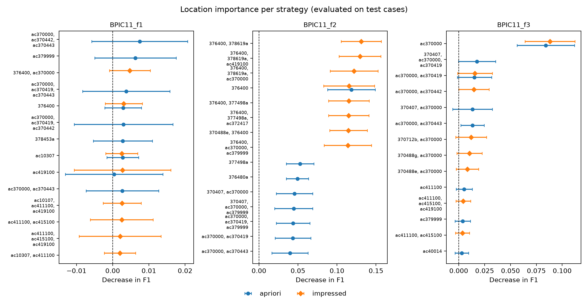

# Job Oosterkamp: full runs of the location permutation importance and the strategy comparison

Date: 22 October 2026. Part of the work of Floris and Job (pipeline from the original paper and data
preparation, see the division of work).

This folder documents what was run, why, how to reproduce it, and what came out.

> **Update (later on 22 October): all code is now one pipeline.** The separate scripts named
> below (`run_location_importance.py`, `compare_strategies.py`, `importance_config.yaml`, ...)
> no longer exist. Everything runs with `python main.py` and one `config.yaml`; see
> "Merging the code into one system" at the end of this file and `Project/code/README.md`.
> The pipeline was rerun after the merge: all 79 CSV files in `results/` came out byte for
> byte identical, so the numbers below are still exactly what the code produces. The **code** that was
added lives in `Project/code/` (where it has to be, so that the project keeps one structure and one set of
entry points). This folder only holds the **documentation, the results and the run logs**, because
`Project/code/results/` is ignored by git and the results would otherwise not be visible to the group.

## Starting point

Max had already reimplemented the pipeline of Vazifehdoostirani et al. (2024) in `Project/code/`:
itemset selection with Apriori and IMPresseD (`itemset_selection/`) and the location permutation
importance (`location_permutation/`, `run_location_importance.py`). It had only been run on BPIC11 f1.
Two things the assignment asks for were missing:

1. results on **all three** BPIC11 logs, and
2. a **comparison** of the two strategies: does the importance of activities and their locations change
   when IMPresseD instead of Apriori chooses the itemsets?

## What was done

| Step | What | Files |
|---|---|---|
| 1 | Added BPIC11 f2 and f3 to the config of the importance pipeline (f1 was already there). | `Project/code/importance_config.yaml` |
| 2 | Ran the full pipeline for all datasets and both strategies, twice: once measuring the F1 drop on the training cases of each fold, once on the test cases (see below). | logs in `logs/`, results in `results/` |
| 3 | Wrote a comparison of the two strategies: overlap of the itemsets, overlap of the top 10, rank correlation, best itemset, and a figure. | `Project/code/compare_strategies.py`, `Project/code/location_permutation/comparison.py` |
| 4 | Added unit tests for the comparison (all 33 tests pass). | `Project/code/tests/test_comparison.py` |
| 5 | Documented the comparison in the code README. | `Project/code/README.md` (section "Comparing the two strategies") |

No existing code of the pipeline or the itemset selection was changed.

### Train versus test evaluation (important for reading the results)

Both runs are complete, independent experiments with identical folds and models (seed 42). In every fold
the model is first trained on 4/5 of the cases. The only difference is **on which cases the F1 drop is
measured** after the permutation (`evaluate_on` in `importance_config.yaml`):

* `train`: on the cases the model was trained on. This is what the reference code of the authors does.
  The model fits these cases almost perfectly (train F1 ≈ 0.99), so almost any permutation lowers F1 and
  importances look larger. On the label-shuffled control this still gives an "importance" of about 0.04,
  although there is nothing to find.
* `test`: on the held-out cases of the fold, which the model has never seen. This shows what the model has
  learned that generalises, and the controls stay near 0. It is also about 4× faster, because only 1/5 of
  the cases are permuted and predicted again.

Which one we report in the paper is still to be decided (see "Open decisions").

## How to reproduce

From `Project/code/`:

```bash
python -m venv .venv
source .venv/bin/activate
pip install -r requirements.txt
python main.py                                                    # 20-25 minutes
python -m pytest
```

(Before the merge this took three commands: `run_location_importance.py --evaluate-on train`,
`run_location_importance.py --evaluate-on test` and `compare_strategies.py`.)

Settings (now in `config.yaml`): 5 stratified folds, 10 permutations per itemset and fold,
feasibility constraint on, seed 42, `exact_tracking: false` and `accumulate_permutations: false`.
Apriori: minimum support 0.5, top 10 multi-activity itemsets plus every single activity, selected on all
cases. IMPresseD: pattern lengths 1-3, selected on 80% of the cases. Python 3.11.5, xgboost 3.2.0.

The results in `results/` are a copy of `Project/code/results/importance/` (and of `results/comparison/` in the new layout) after these commands.

## What is in this folder

```
logs/run_evaluated_on_train.log    console output of the train run (top 10 per strategy, run time)
logs/run_evaluated_on_test.log     console output of the test run
results/<dataset>/evaluated_on_<train|test>/
    <strategy>_summary.csv              mean and std of the F1 drop per itemset, most important first
    <strategy>_location_importance.csv  every value: one column per itemset, 50 rows (5 folds x 10 repetitions)
    <strategy>_fold_scores.csv          train and test F1 of the model in each fold (without permutation)
    <strategy>_boxplot.png              box plot of the 20 most important itemsets
results/comparison/
    comparison_metrics.csv              all comparison numbers, one row per dataset and setting
    <dataset>_<train|test>_top10.csv    top 10 of Apriori and IMPresseD side by side
    comparison_<train|test>.png         figure: the most important itemsets of both strategies per dataset
```

Datasets: `BPIC11_f1`, `BPIC11_f2`, `BPIC11_f3` (the assignment), and `synthetic`,
`shuffled_within_case`, `shuffled_outcomes` (Max's synthetic log with a planted location effect of
activity `b`, and two shuffled copies in which nothing should be found).

### What the comparison measures

| Column in `comparison_metrics.csv` | Meaning |
|---|---|
| `itemsets_apriori`, `itemsets_impressed` | How many itemsets each strategy tested. |
| `itemsets_shared`, `jaccard_itemsets` | How many itemsets both tested, and shared / union. |
| `top10_overlap` | How many of the 10 most important itemsets are the same. |
| `top10_jaccard_activities` | Overlap of the *activities* in the two top-10 lists (looser than the line above). |
| `spearman_shared`, `spearman_p_value` | Rank correlation of the importance of the shared itemsets: does the same itemset get the same rank? |
| `best_*`, `best_*_importance` | Most important itemset of each strategy and its mean F1 drop. |
| `impressed_only_above_best_apriori` | Itemsets only IMPresseD tested that beat Apriori's best one. |

## Results

Model quality (same for both strategies): mean test F1 0.907 (f1), 0.895 (f2), 0.934 (f3); train F1 ≈ 0.99.

### Comparison (`results/comparison/comparison_metrics.csv`)

| | f1 train | f2 train | f3 train | f1 test | f2 test | f3 test |
|---|---|---|---|---|---|---|
| Itemsets Apriori / IMPresseD | 174 / 32 | 217 / 62 | 161 / 29 | 174 / 32 | 217 / 62 | 161 / 29 |
| Shared itemsets | 9 | 8 | 7 | 9 | 8 | 7 |
| Same itemsets in top 10 | 4 | 1 | 3 | 2 | 1 | 2 |
| Spearman on shared itemsets | 1.00 | 1.00 | 1.00 | 0.73 | 1.00 | 0.96 |
| Best Apriori (F1 drop) | ac370000 (0.057) | 376400 (0.137) | ac370000 (0.133) | ac370000, ac370442, ac370443 (0.007) | 376400 (0.118) | ac370000 (0.084) |
| Best IMPresseD (F1 drop) | ac370000 (0.058) | 376400, 378619a, ac370000 (0.168) | ac370000 (0.134) | 376400, ac370000 (0.005) | 376400, 378619a (0.131) | ac370000 (0.088) |
| IMPresseD-only itemsets above best Apriori | 0 | 8 | 0 | 0 | 3 | 0 |



### Synthetic log and controls (best itemset, mean F1 drop)

| Log | train: Apriori / IMPresseD | test: Apriori / IMPresseD |
|---|---|---|
| synthetic (effect planted on `b`) | b, close, register (0.240) / b (0.228) | b, register (0.228) / b, register (0.231) |
| shuffled_within_case (no effect) | b, f, register (0.064) / b, f (0.059) | 0.003 / 0.013 |
| shuffled_outcomes (no effect) | b, close, register (0.039) / b, e (0.042) | c (0.047) / b, d (0.020) |

Both strategies find the planted activity `b`. With only 15 cases these numbers are noisy (std 0.2-0.3).

### What this means

1. **The strategies test almost completely different itemsets.** Only 7-9 itemsets are shared, mostly
   single activities. The two itemset lists overlap for only 3-5% (Jaccard).
2. **For the same itemset the importance does not change.** On the shared itemsets the ranking is (almost)
   identical (Spearman 0.73-1.0). This is expected: the model and the permutation are the same, only the
   choice of itemsets differs. What changes is *which* itemsets get tested.
3. **Both strategies point to the same key activities:** `ac370000` in f1 and f3, `376400` in f2.
4. **IMPresseD needs 3-7× fewer itemsets** (29-62 against 161-217) and is therefore faster.
5. **In f2, IMPresseD finds itemsets that beat Apriori's best one** (3 on test, 8 on train). But almost all
   of them contain `376400`, which alone already drops F1 by 0.116. The other activities add only 0-0.015,
   which is within the standard deviation. So IMPresseD mainly finds *combinations around the same key
   activity*, not clearly new location information. An itemset inherits the importance of its most
   important activity; reporting the gain above the best single activity would make this explicit.
6. **f1 is not informative on test cases:** all effects are below 0.01 and the std is larger than the mean.

## Open decisions for the group

1. Do we report the F1 drop on the training cases (as the reference code) or on the test cases? Possible
   question for Laura (office hour 26 Oct, questions by 25 Oct 15:00).
2. Do we report the importance of an itemset above that of its best single activity (point 5)?
3. Who writes Sections 3 and 4 of the paper before the draft deadline of 28 Oct?
4. ~~The assignment asks for one main method.~~ Done, see below.

## Merging the code into one system

The implementation instructions ask for one main method, parameters in a YAML file, a README
with the exact commands, a complete `requirements.txt` and reproducible results. Before the merge
the code had five entry scripts and two configs. What was changed:

| Before | After | Why |
|---|---|---|
| `main.py` (selection), `run_location_importance.py`, `compare_strategies.py`, `generate_data.py`, `check_controls.py` | one `main.py` with five steps: `generate`, `check`, `select`, `importance`, `compare` (`python main.py --steps ...` runs a subset) | One entry point, as the instructions require. |
| `config.yaml` + `importance_config.yaml` | one `config.yaml` | All parameters in one place. |
| `itemset_selection/experiment.py` (ExperimentRunner) | `pipeline/runner.py` (class `Pipeline`) | Orchestrates all steps; each step reads and writes files, so it can be rerun on its own. |
| The selection report read the raw CSV (`AC370000`, all cases); the importance cleaned the log (`ac370000`, rare cases removed) and selected the itemsets again | Every step uses the cleaned log (`PreparedLog`); step `importance` reads the itemsets that step `select` saved | The selection report and the importance results now describe exactly the same log and itemsets. |
| `itemset_selection/evaluation.py`, `location_permutation/comparison.py`, `check_controls.py` | `evaluation/selection_metrics.py`, `evaluation/strategy_comparison.py`, `evaluation/control_checks.py` | All evaluation code in one package. |
| Apriori sensitivity setting selected on the training split | selected on all cases, like the Apriori baseline; `importance: false` marks it as selection-only | Consistent with the baseline. |
| `requirements.txt` with minimum versions | exact versions (`==`) | XGBoost results can differ between versions. |
| `.vscode` pointed at a personal Python and at removed scripts | points at `.venv` and at `main.py` | Works on every machine. |

Checks after the merge:

* `python main.py` was run in full; all 79 CSV files of the importance and the comparison are
  byte for byte identical to the run before the merge.
* The synthetic data written by step `generate` is identical to the committed files, and step
  `check` gives the same correlations as before.
* The selection gives the same itemsets as the importance used before (e.g. 174 / 32 on BPIC11 f1).
  Only the selection report of the original `main.py` (`results/selection/summary.csv`) changed,
  because it now uses the cleaned log. Measured by running the old `main.py` (commit `f06c250`):

  | | old report | new report |
  |---|---|---|
  | BPIC11 f1: cases / activities / itemsets Apriori, Apriori 0.2-25, IMPresseD | 1140 / 176 / 186, 201, 31 | 1130 / 164 / 174, 189, 32 |
  | BPIC11 f2 | 1140 / 218 / 228, 243, 54 | 1130 / 207 / 217, 232, 62 |
  | BPIC11 f3 | 1121 / 167 / 171, 192, 27 | 1111 / 156 / 161, 181, 29 |
  | SIM_rare_pair: IMPresseD itemsets, location recall, noise-only share | 69.9, 0.50, 0.461 | 68.8, 0.40, 0.445 |
  | SIM_frequent_pair: same | 76.7, 0.50, 0.470 | 68.2, 0.50, 0.440 |

  The BPIC11 numbers drop because the cleaning merges activity names that differ only in case,
  spaces or `-`/`_`, and removes the cases with an activity that occurs only once. The Apriori
  numbers of the simulated logs are unchanged. IMPresseD changes slightly there because the
  cleaning sorts the cases by their id as text, so the 80% training split contains other cases.
  None of the old numbers appear in `main.tex`.
* 37 tests pass (4 new end-to-end tests of the pipeline in `tests/test_pipeline.py`), also in a
  fresh virtual environment installed from `requirements.txt`.
